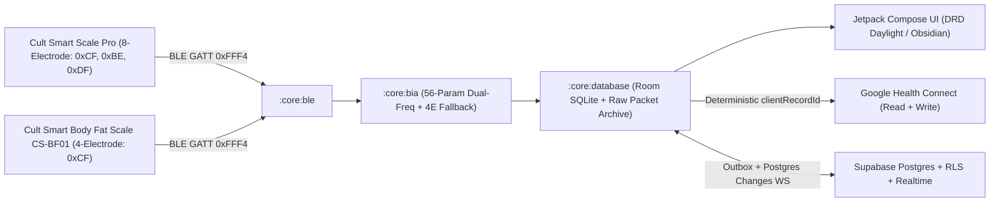

# OpenCult

Unofficial, GPL-3.0 open-source Android companion for the **Cult Smart Scale Pro (8-electrode, 50+ parameters)** and **Cult Smart Body Fat Scale (`CS-BF01`, 4-electrode, 20+ parameters)**, built with Kotlin 2.x, Jetpack Compose, Google Health Connect two-way sync, and Supabase Realtime.

> **Disclaimer:** OpenCult is an independent open-source interoperability project for personal data ownership. It is not affiliated with, endorsed by, or sponsored by Curefit Healthcare Pvt. Ltd., Cult.fit, or Cultsport. Body composition metrics derived from bioelectrical impedance or anthropometric equations are trend estimates, not clinical diagnoses.

---

## Why OpenCult Exists

1. **Direct Google Health Connect Sync:** Auto-writes weight, body fat %, lean body mass, bone mass, body water mass, BMR, and heart rate on every locked weigh-in, and reads back daily Steps, Sleep, and Calories Burned.
2. **All 50+ Parameters Without Paywalls:** Decodes the 8-electrode scale's dual `0xBE` multi-frequency impedance packets (all 10 channels, instead of discarding 9 channels) and computes whole-body, intracellular/extracellular fluid, cellular, metabolic, and 5-segment limb metrics on-device, while keeping every raw `0xCF`, `0xBE`, and `0xDF` frame forever.
3. **Zero-Refresh Supabase Realtime Sync:** Offline-first Room SQLite storage backed by PostgreSQL with Row-Level Security (`auth.uid()`) and live Postgres Changes WebSocket sync across up to 10 household profiles.

---

## Architecture Overview

---

## Governing Documents and Prompts

| File | Purpose |
|---|---|
| [AGENTS.md](AGENTS.md) | Project agent governance, honesty contract, strict UI prototype compliance, Second Brain protocol, GPL-3.0 rules |
| [PRD.md](PRD.md) | Product scope, hardware matrix, complete 56-parameter catalog, Health Connect & Supabase flows |
| [TRD.md](TRD.md) | Stack, BLE wire protocol (`0xCF` / `0xBE` / `0xDF`), BIA math, PostgreSQL DDL, RLS, Realtime, Health Connect |
| [INVARIANTS.md](INVARIANTS.md) | 23 binary architectural, hardware, UI, and motion invariants (`INV-01` .. `INV-23`) |
| [HALL_OF_SHAME.md](HALL_OF_SHAME.md) | Living regression ledger logging root causes, fixes, and prevention rules for every defect |
| [MICROENGINEERING.md](MICROENGINEERING.md) | Applied UI micro-engineering rules, 4-stage interaction contract, 48dp hitboxes, Canvas geometry |
| [MOTIONENGINEERING.md](MOTIONENGINEERING.md) | Closed spring/easing tokens, polar arc & telemetry damping, 120Hz GPU rules, reduced-motion parity |
| [DRD.md](DRD.md) | Design tokens, custom Canvas charts, 9-screen layout spec, Daylight Pastel & Obsidian Night modes |
| [prompts/01_OPEN_DESIGN_PROTOTYPE_PROMPT.md](prompts/01_OPEN_DESIGN_PROTOTYPE_PROMPT.md) | Initial Open Design `# Prototype` prompt |
| [prompts/04_OPEN_DESIGN_PROTOTYPE_V2_PROMPT.md](prompts/04_OPEN_DESIGN_PROTOTYPE_V2_PROMPT.md) | Upgraded v2 Open Design prompt fixing Android bezel, multi-screen gallery, minimalist screenshot parity, and live 4E vs 8E scale switching |
| [prompts/02_AGENTS_GOVERNANCE_PROMPT.md](prompts/02_AGENTS_GOVERNANCE_PROMPT.md) | Governance prompt for `AGENTS.md` and strict UI enforcement |
| [prompts/03_END_TO_END_ANDROID_BUILD_PROMPT.md](prompts/03_END_TO_END_ANDROID_BUILD_PROMPT.md) | Pro long-horizon autonomous build prompt (`ralph-loop`, `/goal`, `/boost`, `rea`, Health Connect, Play Protect, Cloudflare security, Compose UI) |
| [supabase/migrations/20261126000001_opencult_initial_schema.sql](supabase/migrations/20261126000001_opencult_initial_schema.sql) | Supabase Postgres schema, 10-profile trigger, strict RLS, and Realtime publication |

---

## Credits and License

- Protocol and BIA research informed by [oliexdev/openScale](https://github.com/oliexdev/openScale) (`GPL-3.0`) and [anshuman852/occult](https://github.com/anshuman852/occult) (`MIT`).
- Licensed under the **GNU General Public License v3.0 or later** ([LICENSE](LICENSE)).
