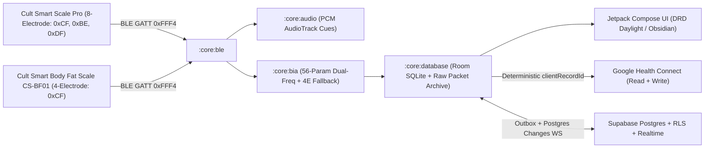

# OpenCult

OpenCult is an unofficial, GPL-3.0 Android companion app for the **Cult Smart Scale Pro** (8-electrode, 56 tracked parameters) and **Cult Smart Body Fat Scale `CS-BF01`** (4-electrode, 20 tracked parameters). It is built with Kotlin, Jetpack Compose, Google Health Connect two-way sync, on-device 44.1 kHz PCM audio cues, offline-first Room storage, and Supabase Realtime with Row-Level Security.

> **Disclaimer:** OpenCult is an independent open-source interoperability project for personal data ownership. It is not affiliated with, endorsed by, or sponsored by Curefit Healthcare Pvt. Ltd., Cult.fit, or Cultsport. Body composition metrics derived from bioelectrical impedance or anthropometric equations are trend estimates, not clinical diagnoses.

---

## Core Capabilities

1. **Google Health Connect Two-Way Sync:** Writes weight, body fat percentage, lean body mass, bone mass, body water mass, BMR, height, and heart rate per locked measurement using deterministic `clientRecordId` keys (`opencult:<measurementId>:<metric>`). Reads daily steps, sleep sessions, active/total calories, and external weight changes (`UpsertionChange` and `DeletionChange`), plus opt-in resting heart rate and background reads.
2. **8-Electrode Dual-Frequency BIA and Raw Archive:** Decodes all 10 impedance channels across both `0xBE` sub-packets (`20 kHz` and `100 kHz`), waits for the `4 x 0xDF` confirmation tail (`1200 ms` grace deadline), and stores every raw `0xCF`, `0xBE`, and `0xDF` frame in SQLite before running calculations on-device.
3. **4-Electrode `CS-BF01` and Feet-Only Honesty:** Disambiguates `CS-BF01` heart rate (`bytes[1]`) and `bytes[5..6]` impedance from legacy `OneByone` frames, generates dynamic `FD 37` XOR unit payloads (`kg`, `lb`, `st`), and suppresses 8-electrode limb or ECW/ICW claims when the hardware provides only single-loop or weight-only data.
4. **Household Matching and Member Lock:** Routes weigh-ins across up to 10 household profiles using rolling weight windows, lets any screen pin readings with `Member Lock`, and cleans up prior Health Connect records before recalculating metrics when a pending weigh-in is reassigned.
5. **Daylight and Obsidian Canvas UI with Synthesized Audio:** Implements a separated 4-tab `#0F1115` capsule dock and Cobalt `+` button, custom Compose `DrawScope` charts (capsule sparkbars, curved wave cards, rounded segmented arc gauge, staggered dot-matrix bars, 5-segment anatomical body map), bundled `Plus Jakarta Sans` and `JetBrains Mono` static fonts, and Hann-windowed `AudioTrack` PCM cues.

---

## Architecture Overview



---

## Governing Documents and Specifications

| File | Purpose |
|---|---|
| [AGENTS.md](AGENTS.md) | Project agent governance, honesty contract, UI enforcement rules, Second Brain protocol, GPL-3.0 compliance |
| [PRD.md](PRD.md) | Product scope, hardware matrix, complete 56-parameter catalog, Health Connect and Supabase flows |
| [TRD.md](TRD.md) | Stack, BLE wire protocol (`0xCF` / `0xBE` / `0xDF`), BIA math, PostgreSQL DDL, RLS, Realtime, Health Connect |
| [INVARIANTS.md](INVARIANTS.md) | 28 binary architectural, hardware, UI, and motion invariants (`INV-01` .. `INV-28`) |
| [HALL_OF_SHAME.md](HALL_OF_SHAME.md) | Regression ledger logging root causes, fixes, and prevention rules for every defect (`SHAME-001` .. `SHAME-019`) |
| [MICROENGINEERING.md](MICROENGINEERING.md) | Applied UI rules, 4-stage interaction contract, `48.dp` hitboxes, Canvas geometry |
| [MOTIONENGINEERING.md](MOTIONENGINEERING.md) | Closed spring/easing tokens, polar arc and telemetry damping, 120 Hz GPU rules, reduced-motion parity |
| [DRD.md](DRD.md) | Design tokens, custom Canvas charts, 9-screen layout spec, Daylight Pastel and Obsidian Night modes |
| [supabase/migrations/20261126000001_opencult_initial_schema.sql](supabase/migrations/20261126000001_opencult_initial_schema.sql) | Supabase Postgres schema, 10-profile trigger, strict RLS, and Realtime publication |

---

## Build and Verification

```powershell
# Run all 14 module JVM / Robolectric unit & UI test suites
.\gradlew.bat testDebugUnitTest --console=plain

# Verify release lint, R8 configuration analysis, and signed release APK
.\gradlew.bat :app:lintRelease :app:analyzeReleaseR8Config :app:assembleRelease --console=plain
```

Required local secrets remain gitignored (`.env.local` for `OPENCULT_SUPABASE_URL` / `OPENCULT_SUPABASE_ANON_KEY`, plus `keystore.properties` and `keystore/` for release signing).

---

## Credits and License

- Protocol and BIA research informed by [oliexdev/openScale](https://github.com/oliexdev/openScale) (`GPL-3.0`) and [anshuman852/occult](https://github.com/anshuman852/occult) (`MIT`).
- Licensed under the **GNU General Public License v3.0 or later** ([LICENSE](LICENSE)).
